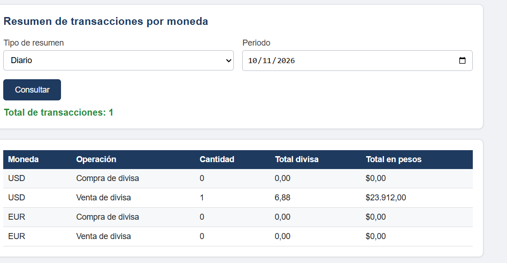

# 💱 Casa de Cambio | Proyecto 4


**Aplicación web para simular operaciones de cambio de divisas y gestionar clientes y transacciones.**

Proyecto académico desarrollado para la asignatura **Diseño de Software II** de la Escuela Tecnológica Instituto Técnico Central.

🌐 **[Ver aplicación publicada](https://jhamesthread.github.io/proyecto-casa-de-cambio/)**

---

## 📑 Tabla de contenidos

- [Descripción](#-descripción)
- [Funcionalidades](#-funcionalidades)
- [Reglas del negocio](#-reglas-del-negocio)
- [Tecnologías](#️-tecnologías)
- [Estructura del proyecto](#-estructura-del-proyecto)
- [Ejecución](#-ejecución)
- [Capturas](#-capturas)
- [Documentación](#-documentación)
- [Pruebas](#-pruebas)
- [Almacenamiento y tasas](#️-almacenamiento-y-tasas)
- [Autor](#-autor)

---

## 📌 Descripción

Casa de Cambio es una aplicación web que permite simular operaciones entre **pesos colombianos (COP), dólares estadounidenses (USD) y euros (EUR)**. También permite registrar clientes, consultar sus datos y revisar resúmenes de las transacciones realizadas.

La aplicación está construida con HTML, CSS y JavaScript, sin necesidad de instalar dependencias para utilizarla.

## 🚀 Funcionalidades

### 💱 Simulador de divisas
- Conversión de COP a USD y de USD a COP.
- Conversión de COP a EUR y de EUR a COP.
- Visualización del valor de referencia y de la tasa aplicada a cada operación.
- Simulación previa antes de registrar una transacción.

### 👥 Gestión de clientes
- Registro de datos personales y de contacto.
- Búsqueda de clientes mediante su número de cédula.
- Consulta de los clientes registrados.

### 📊 Gestión de transacciones
- Registro de operaciones realizadas.
- Validación de las reglas del negocio antes de confirmar una transacción.
- Consulta de resúmenes diarios y mensuales, agrupados por moneda y tipo de operación.

## ⚙️ Reglas del negocio

El sistema aplica las siguientes restricciones al registrar operaciones:

| Regla | Condición |
|---|---|
| Edad | Solo se permiten clientes mayores de edad. |
| Días de atención | De lunes a viernes. |
| Horario | De 8:00 a. m. a 2:00 p. m. |
| Límite diario en COP | $30.000.000 por persona. |
| Límite diario en USD | 3.000 USD por persona. |
| Límite diario en EUR | 2.000 EUR por persona. |

La aplicación también incluye una opción para ignorar el horario durante las pruebas.

## 🛠️ Tecnologías

| Tecnología | Uso |
|---|---|
| HTML5 | Estructura y contenido de la aplicación. |
| CSS3 | Presentación y estilos visuales. |
| JavaScript | Lógica, validaciones y operaciones. |
| LocalStorage | Persistencia local de clientes y transacciones. |
| ExchangeRate-API (Open ER API) | Consulta de tasas de referencia desde internet. |
| GitHub Pages | Publicación de la aplicación web. |

## 📂 Estructura del proyecto

```text
proyecto-casa-de-cambio/
├── index.html
├── README.md
├── css/
│   └── estilos.css
├── js/
│   └── script.js
├── assets/
│   └── imagenes/
│       ├── Clientes.png
│       ├── Simulador.png
│       └── Transacciones.png
└── documentos/
    └── Proyecto_4_Casa_de_Cambio.pdf
```

## 💻 Ejecución

### Opción 1. Aplicación publicada

Accede desde GitHub Pages:

**[🌐 Abrir Casa de Cambio](https://jhamesthread.github.io/proyecto-casa-de-cambio/)**

### Opción 2. Ejecución local

1. Clona el repositorio:

   ```bash
   git clone https://github.com/jhamesthread/proyecto-casa-de-cambio.git
   ```

2. Abre la carpeta del proyecto.
3. Ejecuta el archivo `index.html` en un navegador web.

## 🖼️ Capturas

### Simulador de cambio


### Gestión de clientes


### Resumen de transacciones



## 📄 Documentación

El documento del proyecto contiene información complementaria sobre su desarrollo y funcionamiento.

📘 **[Consultar documentación en PDF](documentos/Proyecto_4_Casa_de_Cambio.pdf)**

## 🧪 Pruebas

Algunos escenarios contemplados para comprobar las validaciones del sistema:

| Escenario | Comportamiento esperado |
|---|---|
| Registrar una persona menor de edad | El sistema rechaza el registro. |
| Intentar una transacción fuera del horario | El sistema informa los días y horas de atención. |
| Superar el límite diario de una moneda | El sistema impide la operación. |
| Realizar una operación con una cédula no registrada | El sistema solicita registrar primero al cliente. |
| Consultar un periodo sin transacciones | El sistema informa que no hay operaciones para ese periodo. |

## ⚠️ Almacenamiento y tasas

- Los clientes y las transacciones se guardan en el almacenamiento local del navegador mediante `localStorage`.
- Los datos no se sincronizan entre dispositivos ni navegadores.
- Borrar los datos del navegador puede eliminar los registros guardados por la aplicación.
- Las tasas iniciales de COP/USD y COP/EUR son valores de ejemplo. Al disponer de conexión, la aplicación intenta consultar tasas de referencia desde una API externa.
- Si la consulta externa falla, se conservan los valores que ya estén en los campos, que inicialmente son valores de ejemplo. Por eso, las tasas deben verificarse y actualizarse antes de utilizar el simulador con valores reales.
- Las tasas consultadas son referencias de conversión y no deben interpretarse automáticamente como una tasa oficial o una cotización comercial garantizada.

## 👨‍💻 Autor

Desarrollado por **[@jhamesthread](https://github.com/jhamesthread)**.

---

**Proyecto académico | Diseño de Software II**
