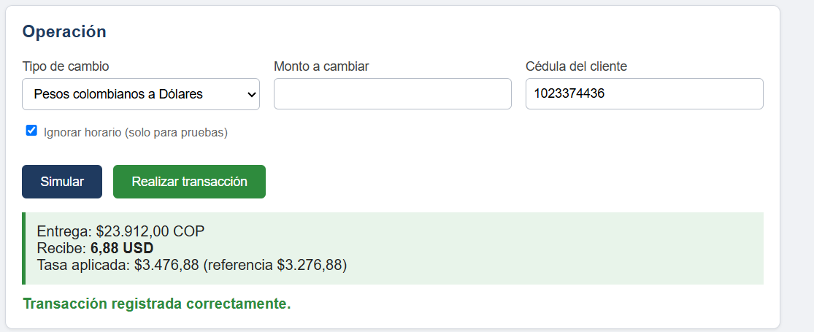
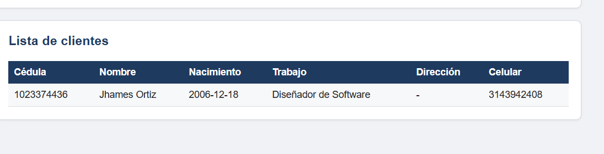

# Casa de Cambio - Proyecto 4

Proyecto 4 de Diseño de Software II.
Escuela Tecnológica Instituto Técnico Central.

Página publicada: https://jhamesthread.github.io/proyecto-casa-de-cambio/

## Descripción

Sistema web para un negocio tipo casa de cambio. Permite simular y hacer cambios de moneda entre pesos colombianos, dólares y euros, usando la tasa representativa del momento.

## Qué hace

- Simulador de cambio de moneda:
  - Pesos a dólares
  - Dólares a pesos
  - Pesos a euros
  - Euros a pesos
- Registro de clientes (cédula, nombre, fecha de nacimiento, trabajo, dirección y celular).
- Consulta de resúmenes diarios y mensuales de las transacciones por moneda.

## Restricciones

- Solo se aceptan transacciones de personas mayores de edad.
- Solo se hacen transacciones de lunes a viernes, de 8:00 a.m. a 2:00 p.m.
- Límites de cambio por persona (en el día):
  - 30.000.000 de pesos
  - 3.000 dólares
  - 2.000 euros

## Tecnologías

- HTML
- CSS
- JavaScript

Los datos se guardan en el navegador (localStorage).

## Archivos

- `index.html`: estructura de la página
- `estilos.css`: diseño
- `script.js`: funcionamiento del sistema

## Cómo usarlo

Opción 1: entrar a la página publicada con el enlace de arriba.

Opción 2: descargar los tres archivos, dejarlos en la misma carpeta y abrir `index.html` en el navegador.

## Capturas

### Simulador

### Transacción realizada

### Clientes

## Pruebas

| Prueba | Resultado esperado |
|---|---|
| Registrar un cliente menor de edad | El sistema no lo deja registrar |
| Cambio fuera del horario | El sistema muestra que solo atiende de 8:00 a.m. a 2:00 p.m. |
| Cambio de más de 3.000 dólares | El sistema avisa que se pasa del límite |
| Cédula no registrada | El sistema pide registrar al cliente primero |

## Integrantes

- Jhames Ortiz Gutiérrez
- Alejandro Rodriguez Fontecha
